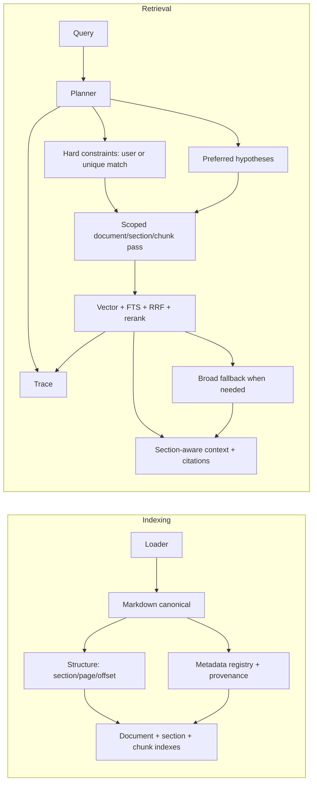

# Kế hoạch production: Structured Markdown + Metadata-aware Retrieval

## Phạm vi

Triển khai luồng trong `docs/New folder/mermaid-diagram.png` cho chat RAG và knowledge search của MiChat. Hệ thống phải tận dụng Markdown canonical, cấu trúc document/section/page, metadata document, hybrid retrieval và citations hiện có; không tạo một pipeline song song.

### Giả định

- Local-first vẫn là mặc định: metadata, retrieval trace và benchmark corpus không rời máy.
- Giai đoạn đầu ưu tiên Markdown, DOCX, PDF và Web; Office không thay đổi contract retrieval.
- User scope được chọn trong giao diện luôn là hard scope.
- Query-inferred metadata chỉ trở thành hard scope khi resolver chứng minh được một match duy nhất; các trường hợp khác là preferred hoặc không áp dụng.
- Chưa thêm dependency mới. SQLite, Drizzle, sqlite-vec, FTS5, Zod và Vitest hiện có là đủ cho giai đoạn đầu.

## Thành công đo được

- Query theo document/section/page chỉ trả citations thuộc scope bắt buộc.
- Query metadata chính xác đưa document nguồn vào top 1 trên benchmark nội bộ; query mơ hồ không làm mất nguồn đúng do hard filter sai.
- Metadata resolver có trace cho mọi quyết định: áp dụng, bỏ qua, fallback và số candidate ở từng tầng.
- p95 retrieval latency và Recall@K không giảm so với baseline đã lưu khi metadata-aware retrieval được bật.
- Reindex, refresh metadata và xóa document/notebook giữ nhất quán relational rows, FTS và các vector index.

## Đối chiếu sơ đồ với hiện trạng

| Nút trong sơ đồ                            | Hiện tại                                                                   | Khoảng trống production                                                                                         |
| ------------------------------------------ | -------------------------------------------------------------------------- | --------------------------------------------------------------------------------------------------------------- |
| Loader trích nội dung                      | Có `MarkdownLoader`, DOCX, PDF, Web loader                                 | Cần corpus test đa nguồn và policy lỗi parser/OCR                                                               |
| MarkdownNormalizer                         | Có; suy lại section từ canonical Markdown để offsets ổn định               | Cần metric coverage: bao nhiêu document có section hợp lệ                                                       |
| Trích section tree/headingPath/offset/page | Có; `ChunkingService` gắn `headingPath`, page metadata, `sectionId`        | Cần contract thống nhất cho quality/coverage và backfill có quan sát                                            |
| Section records + section vectors          | Có `sections`, `vec_sections`, tier section                                | Cần trace và xử lý rõ fallback khi section index chưa phủ đủ                                                    |
| Trích metadata document                    | Có metadata pháp lý có provenance; enrichment có summary/keywords/entities | Entity/tag/date generic chưa có registry, resolver hoặc policy confidence dùng chung                            |
| Document metadata + FTS metadata           | Legal metadata/heading path đã được ghép vào FTS                           | JSON filter nạp document rồi lọc JavaScript; không có index cho notebook lớn                                    |
| Chunk metadata + vectors + FTS             | Có                                                                         | Cần registry để chỉ copy field cho phép xuống chunk/FTS                                                         |
| Query planner                              | Có detector pháp lý nhỏ và user scope                                      | Chưa có plan, confidence, hard/preferred mode hay trace                                                         |
| Candidate scope                            | Có `metadataFilter` document/section/page                                  | Auto-filter hiện có thể thành hard filter sai nếu vẫn trả kết quả                                               |
| Document → section → chunk                 | Có hierarchical retrieval                                                  | Document stage bị skip khi có document scope; đây là side effect không quan sát được, không phải policy rõ ràng |
| RRF + rerank                               | Có hybrid RRF và heuristic rerank                                          | Cần fusion giữa constrained và broad fallback pass                                                              |
| Mở rộng context theo section               | Có `collectContextContents`                                                | Cần budget/trace để biết section expansion có cắt context không                                                 |
| LLM + citation                             | Có                                                                         | Cần citation mang section/page consistently và UI debug ẩn sau feature flag                                     |

### Contract gap cần sửa trước

`KnowledgeService.SearchOptions.hierarchical` có `sectionTopK`; `src/shared/types/knowledge.ts` hiện không khai báo field này dù preload/renderer dùng type shared. Contract phải được hợp nhất trước khi đưa planner ra renderer, nếu không UI có thể không cấu hình được toàn bộ retrieval policy.

## Kiến trúc đích



## Contract đề xuất

Các field mới là optional để `metadataFilter` và callers hiện tại không gãy.

```ts
type MetadataSource = 'user' | 'extractor' | 'enrichment' | 'query-resolver'
type ConstraintMode = 'hard' | 'preferred'

type MetadataPredicate =
  | { field: 'documentId'; op: 'in'; values: string[] }
  | {
      field: 'documentNumber' | 'documentType' | 'issuer' | 'entity' | 'tag'
      op: 'equals' | 'contains'
      value: string
    }
  | { field: 'issuedAt' | 'page'; op: 'between'; from?: string | number; to?: string | number }
  | { field: 'sectionPath'; op: 'pathContains'; value: string[] }

interface RetrievalConstraint {
  source: MetadataSource
  mode: ConstraintMode
  confidence: number
  predicate: MetadataPredicate
}

interface RetrievalPlan {
  version: 1
  constraints: RetrievalConstraint[]
  candidateLimits: { documents: number; sections: number; chunks: number }
}

interface RetrievalTrace {
  version: 1
  plan: RetrievalPlan
  passes: Array<{
    name: 'constrained' | 'broad-fallback'
    candidateDocuments: number
    candidateSections: number
    vectorCandidates: number
    ftsCandidates: number
    returned: number
    latencyMs: number
  }>
  fallbackReason?: 'empty' | 'insufficient' | 'low-score'
}
```

`RetrievalTrace` chỉ trả qua IPC khi `debugRetrieval` được bật trong development/debug panel; production chat chỉ ghi metric tổng hợp cục bộ. Trace không đi vào LLM prompt.

## Kế hoạch theo phase

### Phase 0 — Baseline và contract foundation

#### Task 0.1 — Chuẩn hóa shared retrieval contract

**Mục tiêu:** Một type duy nhất cho main, preload và renderer; thêm `sectionTopK` vào shared contract.

**Files:** `src/shared/types/knowledge.ts`, `src/main/services/KnowledgeService.ts`, `src/preload/index.d.ts`, `src/main/ipc/validation.ts`, `tests/ipcValidation.test.ts`.

**Acceptance:**

- `sectionTopK` được validate, đi qua IPC và đến service.
- Existing callers không phải sửa.
- Invalid values bị từ chối ở IPC boundary.

**Verify:** `pnpm exec vitest run tests/ipcValidation.test.ts tests/rag/hierarchicalRetrieval.test.ts`; `pnpm build`.

#### Task 0.2 — Baseline evaluation corpus và metrics

**Mục tiêu:** Có benchmark để không tối ưu bằng cảm tính.

**Files:** `tests/evals/metadataAwareRetrieval.eval.ts`, `tests/fixtures/rag/metadata-aware/**`, script report trong `scripts/`.

**Cases bắt buộc:** exact document number, exact title, entity, date range, section, page, ambiguous comparison, missing metadata, OCR/incorrect metadata, user hard scope.

**Acceptance:** Báo cáo JSON gồm Recall@K, MRR, citation precision, false-negative rate, p50/p95 latency cho flat hybrid và hierarchical baseline.

**Verify:** `pnpm exec vitest run tests/evals`; report deterministic với fake embeddings.

### Checkpoint 0

- Contract shared/main/preload khớp.
- Benchmark baseline được lưu cục bộ và có threshold được product owner chấp thuận.
- Không thay đổi hành vi chat khi feature flag tắt.

### Phase 1 — Metadata registry và ingest correctness

#### Task 1.1 — Metadata registry có provenance

**Mục tiêu:** Định nghĩa whitelist field, normalizer, operator và policy index thay vì dùng `Record<string, string>` mở.

**Files:** `src/shared/types/retrieval.ts` mới, `src/main/services/MetadataRegistry.ts` mới, `src/main/services/DocumentMetadataExtractionService.ts`, `src/main/services/DocumentEnrichmentService.ts`, tests mới.

**Acceptance:**

- Legal fields, title, section/page, entity, keyword, tag có source/confidence/normalizer.
- Field không đăng ký không thể làm hard filter.
- User correction có ưu tiên cao hơn extractor/enrichment.

**Verify:** unit tests normalizer, precedence, validation and malformed enrichment.

#### Task 1.2 — Canonical ingest projection

**Mục tiêu:** Sau indexing/reindex, metadata document và chunk projection được đồng bộ, idempotent.

**Files:** `KnowledgeService.ts`, `ChunkingService.ts`, metadata registry, `tests/rag/structuralMetadata.test.ts`, `tests/rag/vectorBackfill.test.ts`.

**Acceptance:**

- Markdown/DOCX/PDF/Web canonical content giữ offset ổn định.
- Chunk có `headingPath`, `sectionId`, page metadata và projection registry cho phép.
- FTS nội dung có heading/path và selected metadata theo policy.
- Reindex/backfill chạy hai lần cho cùng dữ liệu không tạo sai khác.

**Verify:** fixture mỗi loader, reindex/backfill/delete cascade tests.

#### Task 1.3 — Metadata catalog cache

**Mục tiêu:** Resolver không scan/toàn bộ parse JSON ở mỗi query trên notebook lớn.

**Files:** `MetadataCatalogService.ts` mới, `KnowledgeService.ts`, cache invalidation tests.

**Acceptance:** Cache notebook bị invalidated khi add/update/reindex/delete; không trả metadata stale.

**Verify:** integration tests cho update/xóa/reindex và perf microbenchmark cục bộ.

### Checkpoint 1

- Ingest đạt coverage metadata/structure có thể quan sát.
- Backfill an toàn trên profile copy; mọi index cleanup vẫn pass.
- Không migration quan hệ mới trước khi benchmark cho thấy cache JSON không đủ.

### Phase 2 — Query planner và safe scope composition

#### Task 2.1 — Resolver trả hypotheses thay vì filter thô

**Mục tiêu:** Thay `detectMetadataFilter()` bằng `resolveQueryMetadata()` trả match, confidence, ambiguity và evidence span.

**Files:** `src/main/services/QueryMetadataResolver.ts` mới, `src/main/utils/queryMetadata.ts`, legal metadata tests.

**Acceptance:**

- Số hiệu/title khớp duy nhất có thể tạo hard constraint.
- Nhiều document/issuer/entity khớp sinh preferred hoặc ambiguity, không chọn tùy tiện.
- Không signal sinh constraint rỗng.

**Verify:** table-driven unit tests tiếng Việt không dấu/có dấu, nhiều số hiệu, dates, aliases, OCR whitespace.

#### Task 2.2 — Retrieval planner và trace

**Mục tiêu:** Tạo `RetrievalPlan` từ user scope + resolver hypotheses và expose trace debug.

**Files:** `RetrievalPlanner.ts` mới, shared types, `KnowledgeService.ts`, IPC validation, preload types.

**Acceptance:**

- User scope luôn hard và không bị broad fallback vượt qua.
- Auto low-confidence chỉ preferred.
- Trace giải thích mọi constraint và candidate count.

**Verify:** contract tests IPC, service integration tests, trace snapshot tests.

#### Task 2.3 — Constrained/broad pass fusion

**Mục tiêu:** Preferred metadata không gây recall regression.

**Files:** `KnowledgeService.ts`, `chatHandlers.ts`, tests/evals.

**Acceptance:**

- Chạy constrained pass trước; fallback broad khi empty, insufficient hoặc low score.
- Merge RRF ổn định, dedupe chunk IDs, giữ citation score/source.
- Không broad fallback với hard user scope.

**Verify:** corpus đối nghịch trong eval: detector sai nhưng constrained pass vẫn có result; nguồn đúng phải còn trong top K sau fusion.

### Checkpoint 2

- Metadata-aware planner bật bằng feature flag cho test profile.
- Không giảm Recall@K baseline vượt ngưỡng chấp thuận.
- Trace chứng minh được mọi filter/fallback trong manual Electron test.

### Phase 3 — Compose hierarchical retrieval và context

#### Task 3.1 — Chính sách document/section tier trong scope

**Mục tiêu:** Document/section hierarchy tuân theo `RetrievalPlan`, không dựa vào các điều kiện `if` ngầm.

**Files:** `KnowledgeService.ts`, `SQLiteDocumentVectorStore.ts`, `SQLiteSectionVectorStore.ts`, `tests/rag/hierarchicalRetrieval.test.ts`.

**Acceptance:**

- Hard document scope: không lấy document ngoài scope; có thể bỏ document-tier do scope đã xác định nhưng section-tier vẫn chạy trong scope.
- Preferred document constraint: document-tier và keyword document selection chạy trong candidate set hợp lệ.
- Section/page hard scope giao đúng với selected section/chunk IDs.

**Verify:** structured Markdown, PDF page fixture, explicit scope, auto hard, preferred and ambiguous cases.

#### Task 3.2 — Context budget theo section

**Mục tiêu:** Context expansion không tràn token budget hoặc làm citation bị mất.

**Files:** `KnowledgeService.ts`, `chatHandlers.ts`, context builder tests.

**Acceptance:**

- Expansion biết section boundary, token budget và selected chunk.
- Citation luôn trỏ matched chunk, title, section, page.
- Khi section quá lớn, chọn lân cận thay vì cắt tùy tiện cả section.

**Verify:** long section fixtures; assertion token budget/citation stability.

### Checkpoint 3

- Manual Electron flow: import MD/DOCX/PDF/Web → inspect metadata → ask exact, structural, ambiguous, page query → inspect citations and debug trace.
- `pnpm exec vitest run tests/rag tests/evals`; `pnpm build`.

### Phase 4 — Scale, operations và rollout

#### Task 4.1 — Feature flags và settings

**Mục tiêu:** Rollout/revert không cần migration rollback.

**Files:** `src/shared/types/index.ts`, config defaults/settings manager, settings validation, chat handler.

**Flags:** `metadataAwareRetrievalEnabled`, `metadataPreferredFallbackEnabled`, `retrievalDebugEnabled` (development only).

**Acceptance:** Per-profile setting; planner off giữ pipeline cũ bit-for-bit ở mức result semantics.

**Verify:** settings migration/default tests and manual toggle.

#### Task 4.2 — Local observability

**Mục tiêu:** Đo chất lượng/latency mà không gửi nội dung ra ngoài.

**Files:** retrieval metrics service mới, `KnowledgeService.ts`, debug UI panel tùy chọn.

**Metrics:** plan mode, candidate counts, fallback rate/reason, p50/p95 latency, rerank method, context tokens, citation feedback outcome.

**Acceptance:** Không log full document/query ở default production logging; có sampling và retention giới hạn.

**Verify:** log schema tests; manual trace export redacts content.

#### Task 4.3 — Relational metadata index, chỉ khi benchmark yêu cầu

**Mục tiêu:** Scale filter từ JSON scan sang indexed SQL.

**Files:** Drizzle schema, migration `00xx`, metadata index repository, backfill job, delete cascade tests.

**Schema:** `document_metadata_values(notebook_id, document_id, field, normalized_value, raw_value, source, confidence, updated_at)` với index `(notebook_id, field, normalized_value, document_id)`.

**Acceptance:** idempotent migration/backfill; query result tương đương JSON implementation; delete/reindex/update không để orphan rows.

**Verify:** fresh DB, populated DB copy, interrupted/restarted backfill, notebook/document cascade, query-plan benchmark.

### Checkpoint 4 / Release gate

- Full `pnpm test`, `pnpm build`, security checks và package smoke test.
- Benchmark không giảm quality/latency vượt threshold chấp thuận.
- Fresh profile và upgraded populated profile đều pass migration/backfill.
- Feature flag rollback được thử trên Electron QA profile.

## Thứ tự và phụ thuộc

```mermaid
flowchart LR
  A[0.1 Shared contract] --> B[0.2 Baseline eval]
  B --> C[1.1 Metadata registry]
  C --> D[1.2 Ingest projection]
  D --> E[1.3 Catalog cache]
  E --> F[2.1 Query resolver]
  F --> G[2.2 Planner + trace]
  G --> H[2.3 Safe fallback fusion]
  H --> I[3.1 Scoped hierarchy]
  I --> J[3.2 Context budget]
  J --> K[4.1 Flags]
  K --> L[4.2 Observability]
  L --> M[4.3 Indexed metadata when needed]
```



## Rủi ro

| Rủi ro                          | Xử lý                                                                    |
| ------------------------------- | ------------------------------------------------------------------------ |
| Metadata/OCR sai làm mất recall | hard chỉ từ user hoặc unique resolution; preferred + broad fallback      |
| Section index chưa phủ đủ       | giữ fallback flat hiện có; trace coverage để biết lý do                  |
| Context tăng quá mức            | section budget, lân cận có giới hạn, token metric                        |
| JSON metadata chậm ở corpus lớn | catalog cache trước; relational index chỉ sau benchmark                  |
| Stale/corrupt index sau reindex | idempotent projection/backfill, transactional boundary rõ, cascade tests |
| Drift IPC type                  | shared contract là source of truth, Zod test tại boundary                |

## Quyết định cần chốt trước khi triển khai

1. Ngưỡng chất lượng để rollout: chấp nhận mức giảm Recall@K/p95 tối đa bao nhiêu?
2. Taxonomy giai đoạn đầu: chỉ legal/contract hay thêm entity/tag do người dùng gắn?
3. Quy mô notebook mục tiêu để quyết định có cần Phase 4.3 ngay từ đầu hay không?
4. Retrieval trace có được hiển thị trong UI debug cho người dùng nâng cao hay chỉ lưu log nội bộ?
