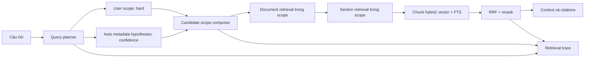

# Đề xuất: Metadata-aware retrieval

## Mục tiêu

Nâng độ chính xác của câu trả lời RAG bằng cách dùng metadata để thu hẹp và xếp hạng lại tập nguồn trước khi đưa ngữ cảnh vào LLM. Metadata không thay semantic search; nó trả lời câu hỏi “tìm trong phạm vi nào” trước khi semantic search trả lời “đoạn nào phù hợp nhất”.

Ví dụ: với câu hỏi “Điều khoản chấm dứt trong Hợp đồng ABC, trang 8 là gì?”, hệ thống phải ưu tiên theo thứ tự: tài liệu ABC → section `Termination` → trang 8 → vector/FTS/RRF/rerank trên các chunk còn lại.

## Phát hiện trong code hiện tại

MiChat đã có nền tảng đáng kể:

| Khả năng | Hiện trạng | Vị trí |
|---|---|---|
| Metadata pháp lý có provenance | Số hiệu, loại, cơ quan, ngày, tiêu đề, căn cứ; có trạng thái trích xuất/chỉnh sửa | `DocumentMetadataExtractionService.ts` |
| Metadata cấu trúc | `headingPath`, trang, section, offsets | `chunks.metadata`, `sections` |
| Filter document/chunk | document ID, loại, nguồn, legal metadata, section path, trang | `KnowledgeService.search()` |
| Hybrid retrieval | KNN + FTS5 + RRF + heuristic rerank | `KnowledgeService.search()` |
| Hierarchical retrieval | Document vector → section vector → chunk | `vec_documents`, `vec_sections` |
| Query metadata legal | Nhận diện số hiệu/loại/cơ quan từ câu hỏi | `queryMetadata.ts` |
| Fallback | Auto legal filter trả rỗng thì chạy lại không filter | `chatHandlers.ts` |

Khoảng trống chính:

1. Auto metadata filter hiện là hard filter; nếu suy luận sai nhưng vẫn trả một kết quả thì không fallback, có nguy cơ mất nguồn đúng.
2. Scope người dùng chọn và filter suy luận từ query dùng chung một object, nên không biểu đạt được mức độ tin cậy hay lý do áp dụng.
3. Khi có document scope, tầng chọn document của hierarchical retrieval bị bỏ qua; tầng section vẫn chạy trong scope. Điều này đúng cho hard scope nhưng cần được biểu đạt rõ trong planner và trace, thay vì là side effect của điều kiện hiện tại.
4. `documentMetadata` là JSON và được lọc bằng cách nạp document rồi so sánh trong JavaScript. Đây là hợp lý ở corpus nhỏ, nhưng không bền vững khi notebook lớn.
5. Chỉ có legal metadata được suy luận từ query. Entity, thời gian, tác giả, loại nội dung, nhãn nghiệp vụ và metadata do người dùng gắn chưa có schema hay resolver chung.
6. Kết quả không trả retrieval trace, nên không biết filter nào đã áp dụng, candidate nào bị loại, hoặc fallback có xảy ra không.
7. Evals hiện kiểm tra recall/citation/scope, chưa đo riêng precision của metadata resolution, false-positive filtering, latency và hiệu quả answer-grounding.

## Kiến trúc đề xuất



### Nguyên tắc quyết định

| Loại điều kiện | Ví dụ | Hành vi |
|---|---|---|
| Hard | Người dùng chọn tài liệu, trang, mục; ID/số hiệu khớp duy nhất | Luôn giới hạn candidate set |
| Preferred | Một cơ quan/loại văn bản suy luận với độ tin cậy cao | Tăng điểm hoặc chạy pass ưu tiên trước |
| Ambiguous | “so sánh nghị định và thông tư”, hai số hiệu, nhiều tổ chức | Không tự lọc; giữ toàn bộ candidate set |
| Fallback | Preferred pass trả ít/không đủ nguồn hoặc score thấp | Hợp nhất với broad pass, không thay thế im lặng |

Không dùng LLM để nhận diện các thuộc tính có thể parse/resolve quyết định được từ dữ liệu đã index. Regex + dictionary + đối chiếu catalog metadata của notebook là đủ cho số hiệu, loại, cơ quan, ngày, tiêu đề/section. LLM enrichment chỉ nên bổ sung entity/keyword/summary với provenance và trạng thái không chắc chắn.

## Hợp đồng dữ liệu đề xuất

Giữ `SearchOptions.metadataFilter` tương thích ngược. Thêm contract mới, không thay nghĩa field hiện có:

```ts
type MetadataPredicate =
  | { field: 'documentNumber'; op: 'equals'; value: string }
  | { field: 'documentType' | 'issuer' | 'entity' | 'tag'; op: 'equals' | 'contains'; value: string }
  | { field: 'issuedAt'; op: 'between'; from?: string; to?: string }
  | { field: 'sectionPath'; op: 'pathContains'; value: string[] }
  | { field: 'page'; op: 'between'; from: number; to: number }

interface RetrievalConstraint {
  source: 'user' | 'query-resolver' | 'policy'
  mode: 'hard' | 'preferred'
  confidence: number
  predicate: MetadataPredicate
}

interface RetrievalPlan {
  constraints: RetrievalConstraint[]
  candidates: { documentLimit: number; sectionLimit: number; chunkLimit: number }
}

interface RetrievalTrace {
  version: 1
  plan: RetrievalPlan
  passes: Array<{
    name: 'constrained' | 'broad-fallback'
    candidateDocuments: number
    candidateSections: number
    vectorCandidates: number
    ftsCandidates: number
    returned: number
    latencyMs: number
  }>
  fallbackReason?: 'empty' | 'insufficient' | 'low-score'
}
```

`RetrievalTrace` chỉ được trả khi người gọi bật `debugRetrieval`; chat production chỉ log metrics đã rút gọn. Không đưa trace nội bộ vào prompt của LLM.

## Mô hình lưu trữ

### Giai đoạn 1 — không migration

Tận dụng `documents.metadata` và `chunks.metadata` hiện có. Chuẩn hóa một namespace chung:

```ts
metadata.retrieval = {
  version: 1,
  fields: {
    documentType: { value: 'contract', source: 'extractor', confidence: 0.98 },
    issuer: { value: 'Chính phủ', source: 'user', confidence: 1 },
    entities: [{ value: 'Coca Cola', source: 'enrichment', confidence: 0.76 }],
    tags: ['finance']
  }
}
```

Sao chép metadata document cần thiết xuống chunk khi index để FTS và diagnostics nhất quán. Không embed metadata vào text chunk thay cho filter; có thể thêm title/heading/selected keyword vào document/section vector input như hiện tại.

### Giai đoạn 2 — migration khi scale yêu cầu

Tạo bảng `document_metadata_values` với `notebook_id`, `document_id`, `field`, `normalized_value`, `raw_value`, `source`, `confidence`, `updated_at`; index `(notebook_id, field, normalized_value, document_id)`. Chỉ migrate các field lọc nhiều: document number, type, issuer, date bucket, tag, entity canonical. JSON vẫn giữ evidence/provenance đầy đủ.

Không tạo bảng EAV tổng quát ngay từ đầu nếu corpus còn nhỏ; nó làm write path và migration phức tạp hơn trước khi chứng minh được nhu cầu.

## Retrieval planner

1. Parse query thành signals có offset và loại signal.
2. Resolve signals với metadata catalog thật của notebook; chỉ sinh hard constraint khi khớp duy nhất hoặc do user chọn.
3. Chuyển match nhiều hoặc confidence thấp thành preferred constraint, không loại document.
4. Apply hard document scope vào document-vector query; vẫn cho hierarchical document/section chạy trong scope đó.
5. Apply hard section/page scope ở section/chunk stage.
6. Chạy constrained pass. Nếu không đạt ngưỡng đủ kết quả/điểm, chạy broad pass và RRF hai pass với ưu tiên nhẹ cho constrained hits.
7. Rerank pool cuối, giới hạn context, tạo citations và trace.

Điểm ngưỡng ban đầu cần được cấu hình và đo bằng eval, không hard-code như quy tắc nghiệp vụ:

```ts
interface MetadataAwareSettings {
  enabled: boolean
  preferredBoost: number       // khởi đầu 1.15
  minConstrainedResults: number // khởi đầu topK
  minConstrainedScore: number   // đo từ eval, không đoán trước
  fallbackEnabled: boolean
}
```

## Kế hoạch triển khai theo lát dọc

### Task 1 — Retrieval plan và trace (M)

- Thêm type `RetrievalConstraint`, `RetrievalPlan`, `RetrievalTrace`; giữ API cũ hoạt động.
- Tách `detectMetadataFilter` thành resolver trả candidates/confidence thay vì chỉ `Record<string,string>`.
- Acceptance: cùng query hiện hữu vẫn cho kết quả cũ khi planner tắt; trace nêu được quyết định và lý do không filter.
- Verify: unit test resolver; `pnpm exec vitest run tests/rag/knowledgeService.test.ts`.

### Task 2 — Compose hard/preferred scope (M)

- Tách explicit user scope khỏi auto hypotheses trong `chatHandlers.ts`.
- Thêm constrained+broad fallback có merge ổn định; không retry nếu user hard scope trả rỗng.
- Acceptance: false-positive preferred metadata không làm mất citation đúng; user scope không bị vượt qua.
- Verify: integration tests với corpus đối nghịch, kiểm tra candidate/citation và trace.

### Task 3 — Compose với hierarchical retrieval (S)

- Cho document/section vector query chạy trong `documentIds` hard scope thay vì tắt hierarchical khi scope có mặt.
- Acceptance: query có document ID + section/page vẫn chỉ trả scope đó và giữ recall.
- Verify: mở rộng `tests/rag/hierarchicalRetrieval.test.ts`.

### Checkpoint A

- `pnpm exec vitest run tests/rag tests/evals`
- `pnpm build`
- Manual Electron: chọn nguồn/trang, hỏi query có số hiệu và query mơ hồ; kiểm tra citation/trace.

### Task 4 — Metadata registry và enrichment contract (M)

- Định nghĩa whitelist field, type, normalizer, operator, source/provenance và policy index.
- Map legal metadata, TOC/page, enrichment entities/keywords, tags người dùng vào registry.
- Acceptance: field không được đăng ký không thể trở thành hard filter; mọi giá trị có normalizer và provenance.
- Verify: schema/contract tests, migration-free backfill test.

### Task 5 — Corpus eval và dashboard metrics (M)

- Lập benchmark có câu hỏi exact metadata, ambiguous, cross-document comparison, entity/time and no-metadata.
- Đo Recall@K, MRR, citation precision, constrained false-negative rate, fallback rate, p50/p95 latency.
- Acceptance: thay đổi retrieval bị chặn khi làm giảm baseline vượt ngưỡng đã chấp thuận.
- Verify: `pnpm exec vitest run tests/evals/ragEval.test.ts` và report JSON cục bộ.

### Task 6 — Chỉ mục metadata quan hệ, nếu benchmark cho thấy cần (L)

- Migrate `document_metadata_values`, backfill có idempotency, query SQL theo index.
- Acceptance: kết quả giống Giai đoạn 1, query không phải nạp toàn bộ metadata notebook.
- Verify: migration on populated profile copy, backfill idempotency and deletion cascade tests.

## Chiến lược đánh giá

Thiết lập hai baseline cố định: flat hybrid hiện tại và hierarchical hiện tại. Mỗi case ghi expected document/chunk/citation, không chỉ expected terms. Báo cáo tách ít nhất năm nhóm:

| Nhóm | Ví dụ | Kỳ vọng |
|---|---|---|
| Exact | “Nghị định 15/2024/NĐ-CP nói gì?” | đúng document đứng đầu |
| Structural | “Termination trong ABC” | đúng section/chunk |
| Page | “trang 8 của ABC” | citation đúng khoảng trang |
| Ambiguous | “so sánh nghị định và thông tư” | không tự hard-filter một nguồn |
| No metadata | câu hỏi semantic thuần | không giảm baseline recall |

## Rủi ro và giảm thiểu

| Rủi ro | Giảm thiểu |
|---|---|
| Metadata sai/lỗi OCR | provenance, confidence, preferred pass và fallback; không dùng low-confidence làm hard filter |
| Recall giảm do filter | hard chỉ từ user/unique resolver; eval chống false negative; broad pass |
| Tăng latency | cache catalog notebook, giới hạn candidate và chỉ chạy fallback khi cần; đo p95 |
| Drift contract IPC | thêm field tùy chọn, validate tại IPC, version trace |
| Lệch chỉ mục sau reindex/delete | viết metadata vào cùng transaction/best-effort policy rõ ràng; backfill và cascade tests |

## Giả định và câu hỏi cần chốt trước khi code

1. Mục tiêu ưu tiên là retrieval cho chat RAG; search UI/debug API sẽ dùng cùng planner sau.
2. Mọi xử lý và chỉ mục tiếp tục local-first, không gửi nội dung/metadata sang dịch vụ bên ngoài.
3. Giai đoạn đầu tập trung tài liệu pháp lý, contract và Office; taxonomy nghiệp vụ cụ thể cần do product owner xác nhận.
4. Cần chốt ngưỡng chất lượng: ưu tiên precision hay recall, kích thước corpus mục tiêu, và tập tài liệu có thể dùng làm benchmark nội bộ.
