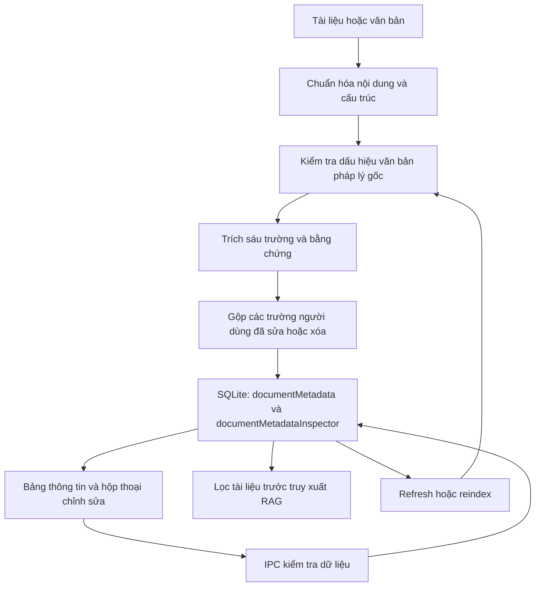

# Kiểm tra luồng và metadata MiChat — 20/10/2026

## Phạm vi và kết quả

Kiểm tra mã, kiểm thử tự động và chạy Electron trên Windows với hồ sơ QA riêng trong thư mục tạm. Không dùng cơ sở dữ liệu người dùng. Workspace có nhiều thay đổi từ trước; báo cáo này chỉ mô tả các sửa chữa của đợt kiểm tra, không quy toàn bộ diff hiện tại cho đợt này.

- Toàn bộ Vitest: **27 tệp, 159 ca đạt, 3 ca bỏ qua**. Các ca bỏ qua phụ thuộc trường hợp không có OfficeCLI; máy kiểm tra có engine.
- Build và typecheck Node/renderer đạt.
- Sau sửa bố cục, Electron xác nhận metadata có clientWidth = scrollWidth = 307 px, bảng liên kết = 322 px; không tràn ngang. ESLint hai thành phần giao diện: 0 lỗi, 4 cảnh báo có sẵn về dependency của hook.
- ESLint các tệp logic metadata và kiểm thử: 0 lỗi, 48 cảnh báo; chủ yếu định dạng và kiểu `any`. Không coi đây là trạng thái sạch cảnh báo toàn dự án.
- Coverage ở lượt kiểm tra trước các sửa metadata: lines 39,97%, statements 39,06%, branches 33,62%, functions 38,85%. Cấu hình hiện tại đo backend/shared; đây không phải coverage toàn ứng dụng hay số đo sau cùng của sửa metadata.

## Luồng metadata

`documentMetadata` chứa giá trị dùng để hiển thị/lọc; `documentMetadataInspector` chứa trạng thái, độ tin cậy và khoảng bằng chứng. Metadata cấu trúc như heading/page được dùng riêng để lọc chunk. Refresh metadata không cần tạo embedding hay thay chunk; reindex còn cập nhật các chỉ mục truy xuất.

## Lỗi đã tái hiện và sửa

| Nhóm | Lỗi | Sửa chữa và xác minh |
|---|---|---|
| Trích xuất | Chọn số văn bản dài hơn trong căn cứ viện dẫn | Chỉ đọc số/ngày trong phần đầu trước căn cứ/nội dung; chọn số xuất hiện đầu tiên. Regression đã thất bại trước khi sửa. |
| Trích xuất | Mượn ngày của luật viện dẫn khi thiếu ngày ban hành | Giới hạn vùng trích ngày; thiếu dữ liệu được giữ là chưa xác định. |
| Ngày tháng | Nhận ngày 31/02; IPC chỉ kiểm tra hình thức | Kiểm tra ngày lịch thật trong extractor và schema IPC; kiểm thử ngày nhuận. |
| Cơ quan | Văn bản một dòng khiến tên bộ bao gồm toàn văn | Cắt tên tại dấu phân cách, quốc hiệu hoặc số văn bản. |
| Nguồn gốc | Lưu một trường biến mọi trường thành người dùng sửa | So sánh từng giá trị, giữ trạng thái/bằng chứng của trường không đổi. |
| Xóa trường | Refresh/reindex làm giá trị đã xóa xuất hiện lại | Lưu dấu xóa rỗng trong inspector; không xuất trường đó vào metadata dùng để lọc. Không tạo dấu xóa cho trường vốn chưa có giá trị. |
| Cấu trúc | Ba bản sao logic trích xuất/gộp/lưu | Dùng chung `refreshDocumentContentMetadata` cho indexing và refresh. |
| Chat | Phản hồi bất đồng bộ làm lẫn notebook/session; mất reasoning-only; abort ghi đè cache mới | Guard theo phiên yêu cầu/session, giữ cache và stream đúng notebook; 9 ca hồi quy store. |
| SQLite | Đóng rồi mở lại vẫn giữ cờ đang đóng | Reset vòng đời kết nối; kiểm tra lại sau await trong checkpoint; regression mở/đóng hai vòng. |
| Job nền | Chạy thủ công không tham gia khóa/đợi shutdown | Dùng chung trạng thái activeRun/running; kiểm thử chặn chạy chồng và shutdown chờ công việc. |
| Xóa notebook | Bỏ sót vector section | Xóa `vec_sections` cùng các chỉ mục khác; xác minh bằng SQLite thật. |
| CSP | Chặn font data và meta chứa chỉ thị không được hỗ trợ | Cho phép font data; giữ frame-ancestors ở response header. |
| Hiển thị | Metadata và nút bị cắt ở cột nguồn hẹp | Một cột cho metadata, cho thanh thao tác và nhãn xuống dòng. |

## Các luồng đã chạy

| Luồng | Cách kiểm tra | Kết quả |
|---|---|---|
| Notebook, ghi chú, xóa | UI và IPC trên Electron | Tạo, sửa, lưu lại và xóa dữ liệu QA thành công |
| Nhập tài liệu, embedding, tìm kiếm | Electron + model embedding local BGE-M3 | Có chunk/vector và tìm đúng nguồn |
| Chat RAG, citation | Gửi từ UI với Gemma local | Trả đúng hạn bàn giao Atlas, citation mở đúng nguồn, lịch sử lưu lại |
| Quiz | Model local, tạo và nộp đáp án qua IPC | Tạo 3 câu theo giới hạn tối thiểu, chấm 100% với đáp án đúng |
| Metadata extractor | Fixture nhiều dòng, một dòng, thiếu ngày, ngày sai, số viện dẫn | Đạt |
| Sửa/xóa, refresh, reindex | Kiểm thử tích hợp SQLite và service | Đạt; giữ sửa/xóa và bằng chứng trường không đổi |
| Lọc theo metadata đã sửa/xóa | Tích hợp và Electron IPC | Cơ quan mới tìm thấy tài liệu; số đã xóa không còn khớp |
| Hộp thoại metadata | Mở UI, đổi cơ quan, bấm lưu, đọc lại DB qua IPC | Đạt; chỉ trường thay đổi mang trạng thái người dùng sửa |
| Office và metadata cấu trúc | Bộ kiểm thử với OfficeCLI thực | Các kiểm thử đang bật đạt; chưa chạy trọn luồng AI tạo Office từ UI |

Bằng chứng runtime: [IPC metadata](2026-10-20-metadata-ipc.json), [lưu từ giao diện](2026-10-20-metadata-ui.json), [ảnh Electron](2026-10-20-metadata.png). Tất cả nội dung pháp lý trong fixture QA là dữ liệu giả để thử parser.

## Giới hạn và việc còn cần theo dõi

- `pnpm audit --prod` trong đợt kiểm tra báo 85 vấn đề phụ thuộc: 55 high, 23 moderate, 7 low. Chưa thay dependency trong đợt này; mức độ advisory không chứng minh mọi đường khai thác đều khả dụng trong ứng dụng. Chưa đủ cơ sở đánh giá bản phát hành an toàn.
- Extractor vẫn là heuristic cho văn bản pháp lý tiếng Việt, không phải bộ phân tích mọi mẫu văn bản/OCR. Cần corpus thực tế có đáp án chuẩn để đo precision/recall.
- Dữ liệu cũ đã bị lưu toàn bộ thành `user_corrected` không thể tự khôi phục nguồn gốc chính xác. Sửa mới ngăn lỗi tiếp diễn, không tự đoán lại lịch sử chỉnh sửa.
- Khi nội dung không còn được nhận diện là văn bản pháp lý gốc, refresh/reindex xóa metadata pháp lý theo hành vi hiện có; ca hồi quy cho báo cáo phân tích vẫn đạt.
- Chưa kiểm tra bộ cài đóng gói, nâng cấp dữ liệu trên máy người dùng, macOS/Linux hay mọi tình huống tải lớn. Không thể suy ra chất lượng toàn hệ thống chỉ từ các ca đã chạy.
- Kiểm thử Node cần `pnpm run test:node-deps`; chạy Electron cần `pnpm run package:deps` vì native SQLite dùng ABI khác. Đóng Electron QA trước khi chuyển ABI.

Các log chi tiết `.audit-*.log` còn trong workspace (được gitignore). Không commit hoặc đẩy thay đổi lên remote trong đợt này.
